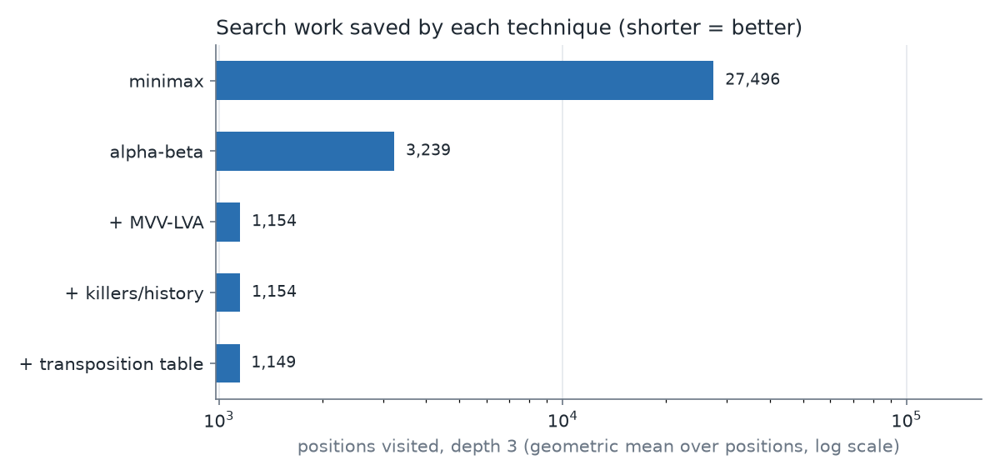
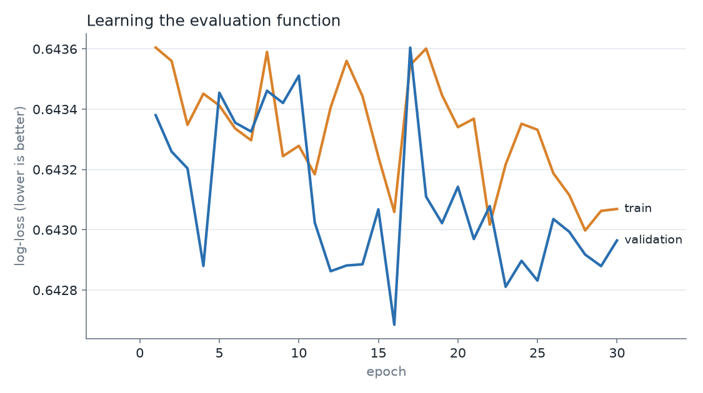
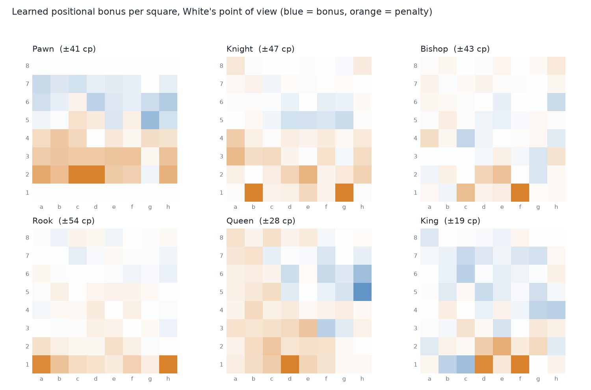
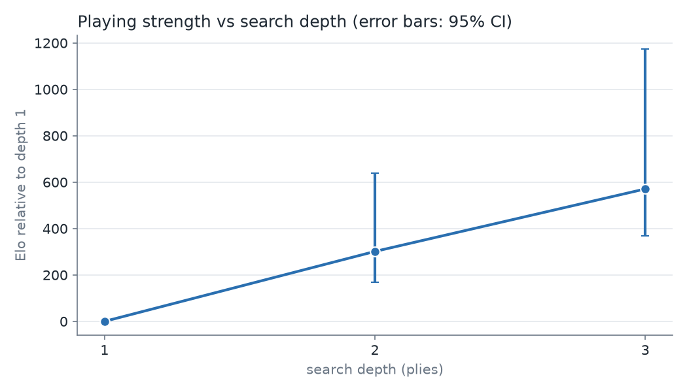

# Chess engine research project: search algorithms + a learned evaluation

A small chess engine written in Python on top of [`python-chess`](https://python-chess.readthedocs.io/)
(used only for move generation and board rules). Everything else is implemented here and **measured**:

1. **Search** – negamax alpha-beta with iterative deepening, MVV-LVA / killer / history move ordering,
   a Zobrist-hashed transposition table and quiescence search, each switchable for ablation studies.
2. **Evaluation** – a linear piece-square evaluation whose 384 weights are *learned from game results*
   (Texel-style logistic regression on positions from Lichess games), compared with a material-only baseline.
3. **Evaluation methodology** – colour-swapped matches from random openings, Elo difference with 95%
   confidence intervals, split-by-game validation to avoid data leakage.

## Research questions

| # | Question | Script |
|---|----------|--------|
| RQ1 | How many nodes does each search technique save, with identical results? | `scripts/exp_search_ablation.py` |
| RQ2 | Does a learned evaluation predict game outcomes better than material counting, and does it play stronger at equal depth / equal time? | `scripts/train_eval.py`, `scripts/run_match.py` |
| RQ3 | How much Elo does each extra ply of search buy (diminishing returns)? | `scripts/exp_depth_ladder.py` |

## Results  *(fill in with YOUR numbers after running the experiments)*

| Experiment | Result |
|---|---|
| RQ1: nodes vs plain alpha-beta, depth 4 | MVV-LVA: 0.12x, + killers/history: 0.12x, + transposition table: 0.10x (about 10x fewer nodes overall), identical scores in all cases |
| RQ2a: validation log-loss (403,013 positions from 67,556 Lichess games, both players rated 1500+; split by game) | coin-flip 0.6931, material 0.6555 → learned 0.6427 (sign accuracy 60.1% → 63.9%) |
| RQ2b: learned vs material, equal depth (3), 60 games (30 random openings, colours swapped) | +55 =4 -1, score 95.0%, Elo diff +512 (95% CI +392 to +913) |
| Extra: quiescence search on vs off (material eval, depth 3), 40 games (20 openings, colours swapped) | +20 =17 -3, score 71.2%, Elo diff +158 (95% CI +81 to +253) |
| RQ3: Elo gain per ply (learned eval, 20 games per step, 10 openings, colours swapped) | d2 vs d1: +15 =4 -1, Elo +301 (95% CI +168 to +638); d3 vs d2: +16 =1 -3, Elo +269 (95% CI +117 to +771); depth 4 not run |

### RQ1 detail: search ablation (8 positions, geometric mean of nodes searched)

| Configuration | Depth 3 nodes | vs alpha-beta | Depth 4 nodes | vs alpha-beta |
|---|---|---|---|---|
| minimax | 27,496 | 8.49x | (skipped, too slow) | |
| alpha-beta | 3,239 | 1.00x | 41,119 | 1.00x |
| + MVV-LVA | 1,154 | 0.36x | 4,877 | 0.12x |
| + killers/history | 1,154 | 0.36x | 4,767 | 0.12x |
| + transposition table | 1,149 | 0.35x | 4,018 | 0.10x |

Findings:
- Alpha-beta searched about 8.5x fewer nodes than plain minimax at depth 3.
- Trying captures first (MVV-LVA) was the largest single gain: about 8x fewer nodes than plain alpha-beta at depth 4.
- The transposition table gave a further, smaller reduction (about 16% fewer nodes than killers/history at depth 4).
- Killers/history had almost no effect at these shallow depths (about 2% at depth 4, none at depth 3).
- The "score differs" check was 0 in every configuration: the techniques changed speed, never the result.
- Caveats: only 8 positions, shallow depths, quiescence search switched off for this experiment.



*Figure 1: positions visited at depth 3 (geometric mean over 8 positions, log scale; shorter is better).*



*Figure 2: training and validation log-loss per epoch for the learned evaluation.*



*Figure 3: learned bonus or penalty per square relative to material values (White's point of view).*



*Figure 4: playing strength relative to depth 1 (error bars: 95% CI).*

Figures are saved in `results/`. See `REPORT_TEMPLATE.md` for how to write them up.

## Quick start

```bash
python -m venv .venv
source .venv/bin/activate          # Windows: .venv\Scripts\activate
pip install -r requirements.txt
python -m pytest -q                # everything should pass before you trust any result
python scripts/play_cli.py --depth 3   # play against it
```

Full step-by-step instructions (data download, training, experiments, report) are in **`GUIDE.md`**.

## Layout

```
chessbot/
  constants.py   material values, feature count
  evaluation.py  feature extraction + linear piece-square evaluator
  search.py      alpha-beta search with switchable techniques
  engine.py      engine = evaluator + search settings (built from a text spec)
  match.py       fair engine-vs-engine matches (colour swap, random openings, multiprocessing)
  stats.py       Elo difference + 95% confidence interval
  data.py        PGN -> labelled training positions
  training.py    Texel-style training loop (numpy)
  uci.py         UCI protocol, so the engine runs in chess GUIs
scripts/         one script per experiment / pipeline step
tests/           unit tests
```

## Limitations (state these honestly in your write-up)

* The evaluation is *linear* (piece-square tables); it cannot represent interactions such as king safety
  vs. attacking pieces. A neural network (e.g. NNUE-style) is the natural next step.
* Labels are game results, which are noisy proxies for position quality (a lost position can still be
  drawn by a blunder). Stockfish evaluations would be a cleaner target.
* Pure Python is roughly 100x slower than a C++ engine, so depths and game counts are small and
  Elo estimates are relative to my own engines, not calibrated to human or FIDE ratings.
* Matches use random 4-ply openings and a draw adjudication at 300 plies.